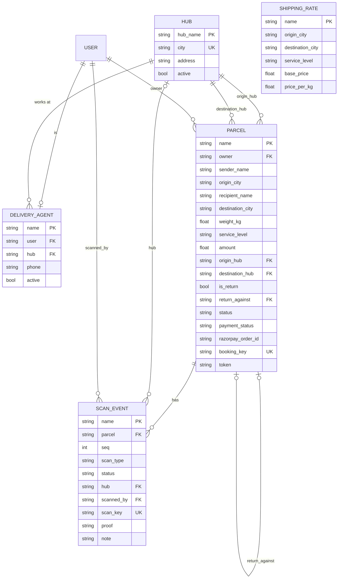

# Courier

A parcel booking and tracking app built on Frappe.

A customer books a parcel, pays, and prints a label with a QR code. Delivery agents
scan the QR at every step until the parcel is delivered. A return is a second parcel
that runs the same steps back. Ops manage hubs, agents and rates in Desk.

Tested on Frappe 16.

## The main idea

Nobody types in a parcel's status. It changes only when the parcel is scanned, and each
scan can move it one legal step.

- Every scan adds a row to the Scan Event log. Rows are never edited or deleted.
- `Parcel.status` is a copy of the latest Scan Event. The log is the source of truth.
- The legal steps are one table in `courier/state_machine.py`.
- The QR holds a signed token (parcel name plus an HMAC), so it cannot be guessed.
- A scan locks the parcel row, so two scans of the same parcel cannot collide.
- A repeated scan changes nothing. A wrong hub or a wrong order is refused with a reason.
- A parcel cannot be picked up before it is paid.

## Payment

Payment goes through the `razorpay_frappe` app. When a Razorpay Order linked to a Parcel
becomes Paid, the Parcel is marked paid, gets its token and its first event
("Booked & Paid"). A repeated confirmation does nothing, and starting a payment twice
reuses the pending order. Payments are recorded in the Razorpay Order record of
`razorpay_frappe`.

## Returns

A return is a second Parcel linked to the first with `return_against`. The sender,
recipient and hubs are swapped, so it starts at the hub where the first parcel was
delivered and walks the same steps. The first parcel stays Delivered. A return is free,
and a parcel can be returned once.

## Data model

The Parcel is the booking and also one physical trip. Shipping Rate is looked up by the
two cities and the service level, so it has no link field. Customers and agents are
normal Frappe users, told apart by their role.

## Where things are

| Path | What it does |
|---|---|
| `courier/state_machine.py` | The table of legal steps and `decide()` |
| `courier/scan.py` | Handles a scan, returns, failed delivery, hold and resume |
| `courier/signing.py` | Makes and checks the barcode token |
| `courier/payment.py` | Starts a payment and marks a parcel paid |
| `courier/pricing.py` | Price lookup and the hub for a city |
| `courier/api.py` | The endpoints the web pages call |
| `courier/notify.py` | Queues the email after each scan |
| `courier/install.py` | Creates the roles on install |
| `courier/hooks.py` | Wires the app into Frappe |
| `courier/courier/doctype/` | Hub, Delivery Agent, Shipping Rate, Parcel, Scan Event |
| `courier/www/scan.html`, `scan.py` | The agent scanner page |
| `courier/courier/doctype/parcel/parcel.js` | The Exception menu in Desk |
| `frontend/src/pages/Home.vue` | The customer app (book, track, label) |
| `courier/tests/` | Unit and integration tests |

`courier/www/courier.py` and the other files in `frontend/` come from the Frappe UI starter.

## Setup

Install the Razorpay app first, because this app needs it:

    bench get-app https://github.com/bwhtech/razorpay_frappe --branch main
    bench --site yoursite install-app razorpay_frappe
    bench get-app https://github.com/sahil123-57/courier --branch main
    bench --site yoursite install-app courier

Add this to `sites/yoursite/site_config.json`. Changing it later makes every existing
barcode invalid.

    "courier_secret": "a-long-random-string"

In Desk, open Razorpay Settings and enter the Key ID, Key Secret and webhook secret.
Point the Razorpay webhook (`payment.captured`) to
`https://yoursite/razorpay-api/webhook-handler`.

Installing creates three roles: Courier Manager (Desk access), Delivery Agent and
Courier Customer.

## Demo data

1. Create a Hub for each city (one hub per city).
2. Create a Shipping Rate for each pair of cities and service level.
3. Create a user for each agent with the role Delivery Agent, then a Delivery Agent record
   linking that user to a hub. Hub scans use the agent's own hub.
4. Create customers as Website Users with the role Courier Customer.

## Customer app

    cd frontend
    npm install
    npm run dev

Open `http://yoursite:8080/courier`. For development only, run
`bench --site yoursite set-config ignore_csrf 1`. Do not use that setting in production.

## Scanner

Agents open `/scan`. It needs the Delivery Agent role, and the camera needs HTTPS or
localhost. There is also a box to paste a token.

## Email

Every scan queues an email to the parcel's owner. It needs an outgoing Email Account.
To try it locally, run a test mail server and add an outgoing Email Account for it:

    pip install aiosmtpd
    python -m aiosmtpd -n -l localhost:1025

Use SMTP server `localhost`, port `1025`, no TLS, no SSL, and tick Default Outgoing.

## Tests

    bench --site yoursite run-tests --app courier

There are 45 tests: 16 unit tests that need no Frappe, and 29 integration tests. The
unit tests can also be run alone:

    python -m unittest courier.tests.test_state_machine

## Not finished

- The Razorpay checkout window has not been tried with test keys. The payment hook is
  tested with Razorpay Order records created in the tests.
- In developer mode with no Razorpay key, the customer app shows a Simulate payment button
  (`dev_simulate_payment` in `courier/api.py`). It is for development only and must be
  removed before real use.
- The customer app runs on the Vite dev server. A production build has not been set up.
- Email was only checked with a local test mail server.
- A scan that arrives late, after the parcel has moved on, is refused as out of order.
- Pickup and delivery scans have no location check, and parcels are not assigned to agents.
- A refund in Razorpay does not change the parcel.
- There is no sign-up screen. Users are created in Desk.
- Route optimisation is not built.
