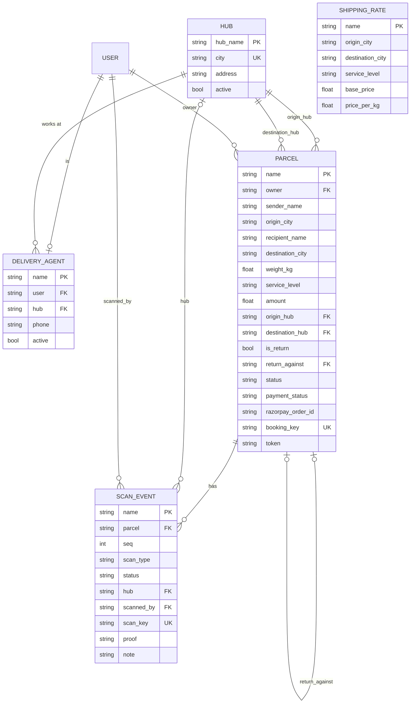

# Courier

A parcel booking and tracking app built on Frappe.

A customer books a parcel, pays, and prints a label with a QR code. Delivery
agents scan the QR at every step until the parcel is delivered. A return runs
the same steps in reverse.

The main rule: nobody types in a parcel's status. It changes only when a
parcel is scanned, and each scan can move it one legal step.

## How it works

- Every scan adds a row to the Scan Event log. Rows are never edited or deleted.
- The status on the Parcel is a copy of the latest Scan Event.
- The legal steps are a table in `courier/state_machine.py`.
- A return is a second Parcel on the same order (`is_return`, `return_against`).
  It is created with sender and recipient swapped and the two hubs swapped,
  so it walks the same steps. The first parcel stays Delivered.
- The QR code holds a signed token (parcel name + HMAC), so it cannot be guessed.
- Payment is confirmed only by Razorpay's signed webhook. A repeated webhook
  does nothing. A parcel cannot be picked up before it is paid.
- Scans are safe to repeat, and each scan locks the parcel row so two scans of
  the same parcel cannot collide.

## Data model

The Parcel is the booking and also one physical trip. A return is a second Parcel
linked to the first by `return_against`. Shipping Rate is looked up by the two cities
and the service level, so it has no link field.

## Doctypes

Hub, Delivery Agent, Shipping Rate, Parcel, Scan Event.

Customers are normal Frappe users with the role Courier Customer.

## Where things are

| Path | What it does |
|---|---|
| `courier/state_machine.py` | The table of legal steps and `decide()` |
| `courier/scan.py` | Handles a scan, returns, failed delivery and hold |
| `courier/signing.py` | Barcode token and webhook signature check |
| `courier/payment.py` | Razorpay order and payment confirmation |
| `courier/api.py` | The endpoints the frontend and scanner call |
| `courier/www/scan.html` | The agent scanner page (camera) |
| `frontend/src/pages/Home.vue` | The customer app (book, track, label) |
| `courier/tests/` | Unit tests |

## Setup

    bench get-app https://github.com/sahil123-57/courier
    bench --site yoursite install-app courier

Add to `sites/yoursite/site_config.json`:

    "courier_secret": "a-long-random-string",
    "razorpay_key_id": "rzp_test_xxx",
    "razorpay_key_secret": "xxx",
    "razorpay_webhook_secret": "xxx"

Point the Razorpay webhook (`payment.captured`, `order.paid`) to
`https://yoursite/api/method/courier.api.razorpay_webhook`.

Run the frontend:

    cd frontend
    npm install
    npm run dev

then open `http://yoursite:8080/courier`.

## Demo data

Create a Hub for each city, a Shipping Rate for each pair of cities, and a user
with the role Delivery Agent plus a Delivery Agent record linked to a hub.

## Tests

    bench --site yoursite run-tests --app courier

## Not finished

- Razorpay has been tested with a simulated webhook, not live test keys.
  In developer mode with no keys, the app shows a "Simulate payment" button.
  That is for development only and must be removed before real use.
- The frontend is run with the Vite dev server, not a production build.
- Email on each scan and proof of delivery are written but not demonstrated.
- Route optimisation is not built.
